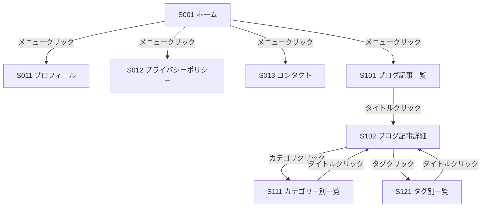

# 画面遷移仕様

## 1. 画面一覧

- すべてのページが認証不要
- 左側にサイドドロワーを配置してメニューを表示
- 記事を表示するサイトなのでエラーは基本的に共通
  - APIが200以外: 記事が取得できませんでした

| ID | 画面名 | ルート | 備考 |
| :--- | :--- | :--- | :--- |
| S001 | ホーム | / | 初期表示 |
| S011 | プロフィール | /profile | |
| S012 | プライバシーポリシー | /policy | |
| S013 | コンタクト | /contact | |
| S101 | ブログ記事一覧 | /blog | 5件/ページ 公開日時降順 |
| S102 | ブログ記事詳細 | /blog/:id | |
| S111 | カテゴリー別一覧 | /blog/category/:id | |
| S121 | タグ別一覧 | /blog/tag/:id | |

## 2. 遷移図

## 3. 画面詳細

- 画面内のリンクをクリックして画面遷移

### S001 ホーム

#### 表示項目

- 配置コンポーネント
  - 固定ページの本文表示（IDを指定）
    - 指定したkeyの本文を取得してページ内に埋め込み
    - key: `PAGE_KEYS.home`
  - 新着ブログ一覧（新着記事3件）

#### 使用API

- **writer.hyperdb.cloud**
  - `GET /sites/:key/contents/:type/latest?limit=3`: 最新コンテンツ一覧
    - `:key`: SITE_INFO.key
    - `:type`: PAGE_TYPE.post

### S011 プロフィール

#### 表示項目

- 配置コンポーネント
  - 記事表示（IDを指定）
    - keyを指定して固定ページを表示する`pages.tsx`を利用
    - key: `PAGE_KEYS.profile`
  - `S102 ブログ記事詳細`と同様の構成です
    - カテゴリー・タグは表示しません

### S012 プライバシーポリシー

#### 表示項目

- 配置コンポーネント
  - 記事表示（IDを指定）
    - keyを指定して固定ページを表示する`pages.tsx`を利用
    - key: `PAGE_KEYS.policy`
  - `S102 ブログ記事詳細`と同様の構成です
    - カテゴリー・タグは表示しません

### S013 コンタクトフォーム

- 配置コンポーネント
  - 固定ページの本文表示（IDを指定）
    - 指定したkeyの本文を取得してページ内に埋め込み
    - key: `PAGE_KEYS.contact`
  - コンタクトフォーム
    - 入力項目
      - 名前（必須）32文字以内・文字種制限なし
      - メールアドレス（必須）
      - 件名（任意）128文字以内・文字種制限なし
      - 本文（必須）1024文字以内・文字種制限なし
    - 別途作成する`contact.hyperdb.cloud`に送信する
    - 基本的に文字種制限なしですが、別のAPIに送信するためNGと思われる文字は除外してください

#### 表示項目

- 配置コンポーネント
  - 記事表示（IDを指定）
  - コンタクトフォーム
    - 共通コンタクト情報API（未実装）に投げる

### S101 ブログ記事一覧

#### 表示項目

- 配置コンポーネント
  - 記事一覧（5件/ページ、公開日降順、ページネーション）

#### 使用API

- **writer.hyperdb.cloud**
  - `GET /sites/:key/contents/:type`: タイプ別コンテンツ一覧
    - `:key`: SITE_INFO.key
    - `:type`: PAGE_TYPE.post
    - ページネーションには`?page={ページ番号}&rows={5}`を使用

### S102 ブログ記事詳細

#### 表示項目

- 配置コンポーネント
  - 記事表示（IDを指定）※カテゴリー・タグ表示あり
  - 記事の表示部分は固定ページなど他のタイプでも利用できるようにする
    - カテゴリーやタグの表示のON/OFF
    - ブログ記事の一覧に戻る場合は表示していたページに戻る
  - 表示部分の構成
    - コンテンツタイトル・コンテンツボディ・コンテンツフッターの3ブロック
      - コンテンツタイトルには以下の項目を表示
        - タイトル
        - 公開日時
        - カテゴリー
      - コンテンツボディには以下の項目を表示
        - コンテンツ本文（取得してきたのはマークダウンなので変換する必要あり）
      - コンテンツフッターには以下の項目を表示
        - タグ一覧
        - 作成日時
        - 更新日時

#### 使用API

- **writer.hyperdb.cloud**
  - `GET /contents/:key`: コンテンツ詳細
    - `:key`: コンテンツのkey
    - 公開中の記事なので認証は不要

### S111 カテゴリー別ブログ記事一覧

#### 表示項目

- 配置コンポーネント
  - 記事一覧（5件/ページ、公開日降順）指定カテゴリーでフィルター
  - 一覧の内容は`S101 ブログ記事一覧`と同様です

### S121 タグ別ブログ記事一覧

#### 表示項目

- 配置コンポーネント
  - 記事一覧（5件/ページ、公開日降順）指定タグでフィルター
  - 一覧の内容は`S101 ブログ記事一覧`と同様です
